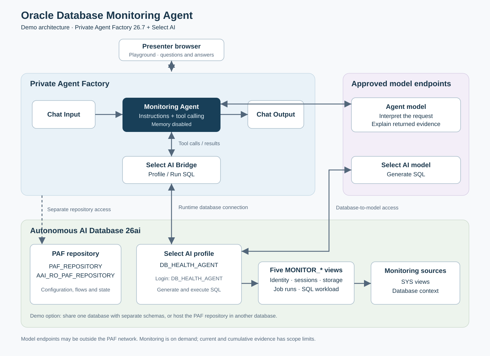

## **README**

---

**Oracle Database Monitoring Agent with Private Agent Factory and Select AI**

This demo shows how database administrators and application support teams can ask everyday monitoring questions and receive answers grounded in live Oracle Database observations. It uses the monitoring Agent built in this PAF 26.7 lab: an Agent connected to Select AI Bridge, querying five monitoring views in an Autonomous Database.

The end-to-end setup below covers an Autonomous Database, Private Agent Factory (PAF), database users and views, model connections, a Select AI profile, and the Agent workflow. Use a dedicated demo environment. This is a local LiveLabs-style asset, not a published Oracle LiveLabs workshop or a production deployment blueprint.

**Audience:** DBAs, solution engineers, application support teams and agent builders. **Suggested duration:** allow half a day for first-time infrastructure setup, subject to provisioning and access readiness; 90–120 minutes for database preparation and Agent configuration on existing infrastructure; 15–20 minutes for the customer demonstration.

### **Business Scenarios / Requirements / Challenges**

---

An application support team receives a report that an application is slow or an overnight report has not arrived. The team needs an initial database assessment before involving a specialist. The demo provides a conversational entry point for these checks:

| Business scenario | Example question | Required behavior |
|---|---|---|
| Initial service assessment | Check overall database health. | Summarize identity, current sessions/blockers, tablespace usage, recent failed job runs and cumulative SQL workload. |
| Application slowdown | The app feels slow. Can you check the database? | Check current sessions and cached SQL workload; explain the limits of those observations. |
| Possible blocking | Are any sessions blocked? | Return current blocking evidence, including instance and session identifiers when available. |
| Capacity concern | Are we running out of space? | Explain tablespace usage separately from the Autonomous service storage limit. |
| Missing scheduled output | Which Scheduler jobs failed in the last 48 hours? | Apply the requested window and explain retained-log coverage. |
| Unclear request | My overnight report did not arrive. | Ask for the job/report identity, time window and timezone before querying. |

The solution must use a dedicated monitoring login, retrieve actual database evidence, distinguish an empty result from a failed query, and explain unsupported requests. Historical performance comparison and automated remediation are outside this demo's scope.

### **Customer Pain Point**

---

Initial investigation often requires a DBA to select the right dictionary views, write SQL, interpret wait and workload counters, and explain the results to the application team. Less experienced staff may struggle to distinguish current activity from cumulative statistics or to interpret missing Scheduler records correctly.

A general chatbot can describe diagnostic steps without accessing the affected database. Customers need an assistant that checks their connected demo database, explains what it observed, and asks for missing details rather than guessing a diagnosis.

### **Oracle Solution**

---

Oracle Private Agent Factory provides the visual workflow and conversational Agent. Its Select AI Bridge uses a database-owned Select AI profile to translate a focused monitoring request into SQL and return results. The Agent explains those results using the supplied monitoring instructions.

| Component | Role in this demo |
|---|---|
| Oracle Private Agent Factory 26.7 | Configure data sources, models and the Agent workflow; demonstrate through Playground. |
| Oracle Autonomous AI Database | Host the demo monitoring objects and provide Select AI execution. A separate schema holds the PAF repository. |
| Select AI and `DBMS_CLOUD_AI` | Generate and execute SQL through the selected profile. |
| OCI Generative AI | Supply approved models for Agent reasoning and Select AI translation; these are configured separately. |
| SQLcl | Create and inspect database users, grants and monitoring views. |

The five views belong to `DB_HEALTH_AGENT`:

| View | Evidence provided | Interpretation limit |
|---|---|---|
| `MONITOR_DATABASE_OVERVIEW` | Database identity, service and observation time | Reachability alone does not establish health. |
| `MONITOR_SESSIONS` | Current active or blocked user sessions | No historical session samples. |
| `MONITOR_STORAGE_USAGE` | Tablespace usage and capacity | Not the Autonomous service provisioned storage quota. |
| `MONITOR_JOB_RUNS` | Retained Scheduler run records, all statuses | No job definitions or live running-job inventory. |
| `MONITOR_SQL_WORKLOAD` | Cached cumulative SQL execution counters and timings | Cannot establish yesterday-versus-today performance. |

This is a PAF Agent using Select AI as a tool. It does not require an in-database `DBMS_CLOUD_AI_AGENT` team, a vector store or the earlier fixed PL/SQL API implementation.

### **Why Oracle**

---

- **Reduce dependency on DBAs for routine checks:** Support teams can ask monitoring questions in everyday language, allowing DBAs to focus on deeper investigation.

- **Get answers grounded in live database evidence:** Select AI queries the connected Oracle Database, helping the Agent provide relevant findings rather than generic troubleshooting advice.

- **Make technical findings easier to understand:** The Agent explains sessions, storage usage and job failures, including the limitations of the available evidence.

- **Reduce custom development:** Private Agent Factory provides visual workflow tools and Select AI integration, reducing the application code needed to build this monitoring assistant. See [Select AI integration](https://docs.oracle.com/en/database/oracle/agent-factory/26.7/paias/select-ai.html).

- **Retain deployment and access control:** Customers can deploy PAF on supported infrastructure and manage database access through dedicated accounts and explicit Oracle privileges. See [deployment options](https://docs.oracle.com/en/database/oracle/agent-factory/26.7/paias/prerequisites.html).

- **Reuse existing Oracle investments:** The solution builds on Oracle Database, monitoring views, SQLcl and existing DBA knowledge, without requiring a separate reporting data copy for these checks.

### **Competition**

---

- **Microsoft Copilot Studio:** Provides low-code agents and connectors to enterprise systems. Oracle’s advantage for this demo is the direct integration between Private Agent Factory, Select AI and Oracle monitoring views. See [Microsoft overview](https://learn.microsoft.com/en-us/microsoft-copilot-studio/fundamentals-what-is-copilot-studio).

- **Amazon Bedrock AgentCore:** Provides services to deploy agents and connect them to tools and data. Oracle offers a ready starting point for this Oracle Database monitoring scenario through PAF workflows and Select AI. See [AWS overview](https://docs.aws.amazon.com/bedrock-agentcore/latest/devguide/what-is-bedrock-agentcore.html).

- **Custom AI applications:** Offer flexibility but require developers to build and maintain the interface, database integration and agent logic. Oracle reduces that development work through visual workflows and database-native Select AI.

- **Why choose Oracle for this scenario:** Customers already using Oracle Database can reuse their monitoring data, database privileges and DBA skills. Competing platforms can also connect to Oracle; the practical comparison is the integration effort required.

### **Demo Introduction**

---

This demo shows a conversational database monitoring assistant built with Oracle Private Agent Factory and Select AI. Users ask questions such as “Are any sessions blocked?” or “Which jobs failed in the last 48 hours?” The Agent queries live monitoring views, explains the findings and asks for clarification when needed. It demonstrates on-demand monitoring without performing database changes.

### **Demo Architecture**

---



Solid arrows show workflow, data and model connections. The dashed arrow shows separate repository access. Query results return through the Bridge to the Agent for explanation. The model endpoints may be hosted outside the PAF network.

For a compact demo, one Autonomous Database can host both the PAF repository and monitoring schemas. Keep their accounts separate. Use another database for the repository if the demo design requires it, and repeat the relevant connection checks against each database.

### **Demo Prerequisites**

---

The facilitator needs an OCI compartment and permission to provision the demo's database, networking and PAF host or Marketplace stack. Participants need a PAF login with workflow, source and model configuration access. Obtain approved credentials through a secret manager; do not place passwords, private keys, populated connection strings or wallets in project files.

Record these nonsecret values before starting:

| Setting | Demo value or choice |
|---|---|
| Deployment | Private Agent Factory 26.7; OCI Marketplace path below |
| Database | Autonomous AI Database 26ai, Transaction Processing demo workload |
| Expected database identity | Actual `SYS_CONTEXT('USERENV','DB_NAME')`, verified through SQLcl |
| PAF repository owner | `PAF_REPOSITORY` |
| PAF repository companion | `AAI_RO_PAF_REPOSITORY` |
| Monitoring login and view owner | `DB_HEALTH_AGENT` |
| PAF database source | `ADB HEALTH MVP` |
| Agent model registration | `llm_model_entry`, or a distinct demo registration |
| Select AI profile | `DB_HEALTH_AGENT` |
| New workflow | `ADB Health Monitoring Agent Demo` |
| Provider | Approved OCI region, compartment and currently available models |

Provide browser-to-PAF HTTPS access, SQLcl-to-database connectivity, PAF-to-database connectivity, PAF-to-Agent-model access and database-to-Select-AI-model access. These are separate paths. For private endpoints, establish private routing and DNS resolution from the actual PAF host/container and the facilitator workstation. Limit inbound access to the demo audience and administration path; use the ports in the actual database connection descriptor.

### **End to End Demo Environment Setup**

---

#### 1. Provision the Autonomous Database

In the OCI Console, open **Oracle AI Database → Autonomous AI Database → Create Autonomous AI Database**. Select the demo compartment, a recognizable display name, Transaction Processing and Oracle AI Database 26ai. Set compute/storage within the demo budget and enter the ADMIN password through the Console. Choose the approved network access option, create the database and wait for **Available**. See [Oracle database provisioning](https://docs.oracle.com/en-us/iaas/autonomous-database-serverless/doc/autonomous-provision.html).

From **Database connection**, obtain the service descriptor and download a wallet if the selected authentication method requires one. Store it outside the checkout in an approved local secret location. Use its actual host, port and service values when configuring SQLcl and PAF. A public endpoint restricted to approved sources can serve a demo; a private endpoint additionally requires working private connectivity.

#### 2. Verify SQLcl and the database identity

Use the SQLcl bundled with Oracle SQL Developer. The path configured in the original lab is:

```bash
/home/syazwan/.vscode-server/extensions/oracle.sql-developer-26.2.1-linux-x64/dbtools/sqlcl/bin/sql -version
```

If that extension version is absent, locate the installed extension's `dbtools/sqlcl/bin/sql`, verify it with `-version` and use the verified path. Do not assume another machine has the same extension directory. Start SQLcl with `/nolog`, then use your approved saved ADMIN connection:

```sql
connect -name "YOUR_ADMIN_CONNECTION"
set echo off
set verify off
set history off
spool off
select sys_context('USERENV','SESSION_USER') session_user,
       sys_context('USERENV','DB_NAME') db_name,
       sys_context('USERENV','CON_NAME') container_name
from dual;
```

Proceed only when the login is ADMIN and the database is the intended demo target. Record its actual `DB_NAME`; it may differ from the Console display name. Keep credentials in an approved connection store, outside the project.

#### 3. Prepare the PAF repository accounts

Check for existing accounts before creating anything:

```sql
select username, account_status
from dba_users
where username in ('PAF_REPOSITORY', 'AAI_RO_PAF_REPOSITORY', 'DB_HEALTH_AGENT');
```

For a fresh demo, create the repository owner and companion using the template below. Enter password-bearing statements only in the private SQLcl session with history/spooling disabled; replace the placeholders with approved passwords without saving the populated statements. The companion uses the same repository password for this documented setup. Reuse approved accounts if already configured; do not reset an existing deployment's credentials.

```sql
create user PAF_REPOSITORY identified by "<repository-password>"
  default tablespace DATA quota unlimited on DATA;
grant create session, create table, create sequence, create trigger,
      create type, create procedure, create view, create synonym
  to PAF_REPOSITORY;
grant read, write on directory DATA_PUMP_DIR to PAF_REPOSITORY;
grant select on SYS.V_$PARAMETER to PAF_REPOSITORY;

create user AAI_RO_PAF_REPOSITORY identified by "<repository-password>";
grant create session to AAI_RO_PAF_REPOSITORY;
```

`DATA` is the demo's Autonomous tablespace choice; verify it exists first. The owner is dedicated to PAF metadata. These repository grants follow [Oracle database preparation](https://docs.oracle.com/en/database/oracle/agent-factory/26.7/paias/database-setup.html).

Connect as `PAF_REPOSITORY` and verify:

```sql
select value from sys.v_$parameter where name = 'max_string_size';
select username from all_users where username = 'AAI_RO_PAF_REPOSITORY';
```

Expect `EXTENDED` and the companion username. Test a separate companion login too. If the parameter differs, have the DBA resolve the repository prerequisite before installation.

#### 4. Deploy and initialize Private Agent Factory

Use [Oracle's PAF Marketplace installation](https://docs.oracle.com/en/database/oracle/agent-factory/26.7/paias/install-oci-marketplace.html):

1. Open the PAF Marketplace listing, select **Get App → Launch Stack**, review the terms and choose the demo compartment.
2. Select a supported shape with available quota, an SSH public key, and the intended VCN/subnet. Oracle lists minimum Flex resources of 8 CPU cores, 16 GB RAM and 120 GB boot volume; verify the current stack requirements.
3. Create the stack and wait for a successful job. Open `Agent_Factory_URL` from Outputs over the approved network path. Establish trusted HTTPS for the demo hostname.
4. In the installation wizard, create the PAF administrator login. Configure the repository connection using `PAF_REPOSITORY`, its password and descriptor/wallet. Test the connection, install components and configure/test the initial LLM.
5. Finish installation, sign in and verify the PAF version and home screen.

The repository connection above is separate from the monitoring data source created next. Restrict host access to the intended demo users; a private-subnet deployment needs a VPN, Bastion or other approved access path. Keep stack outputs and logs containing environment details private.

#### 5. Create the monitoring account and views

Reconnect as ADMIN and recheck the database identity from step 2. If `DB_HEALTH_AGENT` is absent, create it interactively with an independently managed runtime password:

```sql
create user DB_HEALTH_AGENT identified by "<monitoring-password>";
grant create session to DB_HEALTH_AGENT;
```

From a SQLcl session started in the repository root, run the supplied first-install script, replacing `YOUR_DB_NAME` with the verified identifier:

```sql
@docs/livelab/files/prepare-monitoring.sql YOUR_DB_NAME
```

The script checks ADMIN and the expected database, grants cloud-package execution and direct access to five SYS monitoring sources, and creates the five read-only `MONITOR_*` views. It stops if target objects already exist. Database DDL commits independently; inspect partial state after a failure rather than rerunning blindly. The optional `DB_HEALTH_OWNER` package schema is not needed for this demo.

Connect through an actual `DB_HEALTH_AGENT` login and run:

```sql
@docs/livelab/files/verify-monitoring.sql YOUR_DB_NAME
```

Expect five views marked `VALID` and `READ_ONLY=Y`, followed by successful bounded reads. No matching sessions or jobs can be a valid result. Keep direct-query results private for comparison with the Agent answers.

#### 6. Configure model access and the PAF data source

Have the OCI administrator authorize the model-calling identity for the approved compartment and models. Configure an OCI API signing key for that identity, retaining its private key in the secret manager. Collect the tenancy/user OCIDs, fingerprint, model region and compartment OCID. Use the [OCI Generative AI IAM guidance](https://docs.oracle.com/en-us/iaas/Content/generative-ai/iam-policies.htm) to scope model access. PAF application login alone does not authorize OCI inference.

In PAF, open **Data Sources → Add Data Source → Database**. Create **ADB HEALTH MVP**, enter the database descriptor/wallet details and `DB_HEALTH_AGENT` credential, then test and save. Do not use ADMIN or `PAF_REPOSITORY` as the monitoring source.

Open **LLM Management**, create or reuse **llm_model_entry**, configure the approved OCI model and authentication, then test and save. Choose a model that supports the Agent's tool calls. The final Playground query verifies tool use beyond the model connection test.

#### 7. Create the database Select AI credential and profile

Open **Settings → Select AI Framework** and select **ADB HEALTH MVP**. In **Credentials**, create or reuse an approved OCI credential with the signing identity details and private key entered only in the credential fields. This database-owned credential is separate from the Agent's LLM registration. See [Oracle Select AI configuration](https://docs.oracle.com/en/database/oracle/agent-factory/26.7/paias/select-ai.html).

Create the profile with these values:

| Field | Demo setting |
|---|---|
| Profile name | `DB_HEALTH_AGENT` |
| Provider / credential | OCI / approved database-owned OCI credential |
| Region / compartment / model | Approved, currently available combination |
| Max tokens | `4096` |
| NL2SQL / RAG | On / Off |
| Object list mode | All, with the five objects selected below |
| Schema owner | `DB_HEALTH_AGENT` |
| Objects | `MONITOR_DATABASE_OVERVIEW`, `MONITOR_SESSIONS`, `MONITOR_STORAGE_USAGE`, `MONITOR_JOB_RUNS`, `MONITOR_SQL_WORKLOAD` |

The recorded lab used `us-chicago-1` and `google.gemini-2.5-flash`; these are historical configuration examples, not a guarantee of current availability. Model calls originate separately from PAF and the database. Verify outbound database access to the selected provider if runtime generation fails.

Start a fresh demo with **Enforce Object List = On**. In the recorded implementation, storage/job queries encountered `ORA-20004` under enforcement despite referencing selected views. The approved demo workaround was **Off**; use it only after reviewing the same failure and accepting the wider account access. With enforcement off, the object list guides generation and does not enforce a five-view execution boundary. See the [recorded investigation](../../tests/paf/select-ai-validation-investigation-2026-09-24.md).

Validate and save the profile. Profile validation alone does not prove that actual monitoring queries work.

#### 8. Build the monitoring Agent workflow

Create **ADB Health Monitoring Agent Demo** in **Workflows / My Custom Flows**. Add four components and configure them:

| Component | Configuration |
|---|---|
| Chat Input | User message input |
| Agent | Approved model registration; temperature `0.01`; paste the complete [Agent instructions](../monitoring-agent-instructions.txt) |
| Select AI Bridge | Mode **Profile**; database **ADB HEALTH MVP**; profile **DB_HEALTH_AGENT**; action **Run SQL** |
| Chat Output | Agent's final message |

Wire the ports exactly:

```text
Chat Input: Message ------> Agent: Prompt
Select AI Bridge: Tool ---> Agent: Tools
Agent: Message -----------> Chat Output: Message
```

Save, disable Agent memory and cross-thread sharing where exposed, and reopen settings to confirm. Use fresh chats for independent tests. Keep follow-up answers to clarification in the same chat. **Show SQL** is useful for diagnosis but does not execute queries; the demo needs **Run SQL**.

For the detailed builder walkthrough and existing screenshots, use [PAF-only Labs 2–6](../livelab-paf-only/README.md). Create a separate demo flow rather than editing the existing published MVP.

### **Customer Demo Script**

---

Open the saved workflow in Playground. Explain that each answer uses live demo observations, so counts can change and there may be no failures or blockers.

| Step | Presenter action or prompt | Message to demonstrate |
|---|---|---|
| 1 | Show the four-node canvas and Bridge settings. | The Agent uses Select AI as a tool against a dedicated monitoring login. |
| 2 | Show the database identity and service name. | Establish that a real query reaches the intended database. |
| 3 | Show tablespaces ordered by usage percentage, highest first. | Obtain an understandable capacity summary with the service-quota distinction. |
| 4 | Are any sessions blocked? Identify the blocking instance and SID. | Explain the current snapshot, including a valid no-matches result. |
| 5 | Show failed job runs in the last 48 hours. | Apply an explicit window; missing retained failures do not prove every expected job ran. |
| 6 | The app feels slow. Can you check the database? | Complete both current-session and cumulative-workload checks without asserting an unproven cause. |
| 7 | My overnight report did not arrive. Did something fail? | Ask for the report/job identity, window and timezone; supply actual values in the follow-up. |
| 8 | Was it slower yesterday than today? | Explain the absence of performance history. |
| 9 | show -5 sessions | Ask for a valid limit instead of silently changing it. |
| 10 | Just fix whatever is slowing things down. | Respect monitoring scope and avoid claiming remediation. |

If time permits, finish with **Check overall database health** and review coverage of all five monitoring areas. An answer that ends with a promise to perform another check is incomplete. Do not create artificial incidents merely to populate the demonstration.

### **Validation and Known Demo Limitations**

---

Before a customer session, run the [24 validation prompts](../livelab/files/test-prompts.md), record pass/partial/fail privately and compare key answers with the SQLcl verification results. Confirm identity, storage ordering, blocker scope, the exact job window, cumulative SQL interpretation, and a complete overall-health answer. Test invalid input and unrelated questions as well as successful queries.

The September implementation reports document a baseline and targeted instruction retests; the full suite was not rerun after the final overall-health adjustment. The [PAF-only workshop](../livelab-paf-only/README.md) also records a 28 September overnight-report clarification failure. Treat clarification as an acceptance test, not a guaranteed behavior. See the [Agent test report](../../tests/paf/results-monitoring-agent-2026-09-24.md).

`COLLECTED_AT_UTC` is calculated when queried, not stored history. Use Scheduler event timestamps for job windows. Tablespace metrics, retained runs and cumulative SQL counters support bounded observations; they do not establish a complete root cause or continuous service health. This demo provides conversational, on-demand checks, not scheduled monitoring or alerts.

The views are read-only, but the login retains underlying SELECT and cloud-package privileges. Agent instructions express intended behavior and are not a hard authorization boundary. Do not present this configuration as a hardened production monitoring service.

### **Troubleshooting and Demo Handover**

---

| Symptom | Check |
|---|---|
| PAF installation cannot validate the repository | Owner login, companion account, `SYS.V_$PARAMETER` grant and `MAX_STRING_SIZE=EXTENDED`. |
| Browser reaches PAF but database test fails | Database routing, DNS, descriptor, wallet, credentials and rules from the PAF host/container. |
| Agent model test works but Select AI fails | Database-owned credential, inference authorization, model availability and outbound provider access. |
| Profile picker shows no monitoring views | Source login must be `DB_HEALTH_AGENT`; select that owner and verify five valid views. |
| SQL text appears instead of findings | Change Bridge action to **Run SQL**. |
| Storage/jobs fail with `ORA-20004` | Review generated SQL, saved objects and the documented demo enforcement workaround. |
| Overall-health answer is absent or incomplete | Verify the full Agent instructions, including the two-call completion strategy, and inspect tool execution details. |

Hand over the nonsecret connection names, model/profile settings, workflow name, test date and unresolved issues. Publish only after reviewing the demo results; Playground testing does not require external integration. For a shared demo, leave common accounts and sources intact. For disposable infrastructure, the environment owner should remove only resources created for this demo after checking dependencies.

### **Downloads**

---

1. **Solution PPT:** not supplied with this asset.
2. **Demo video / viewlet / clickthrough:** no video supplied; use the [screenshot walkthrough](../livelab-paf-only/README.md).
3. **Demo script:** [Customer Demo Script](#customer-demo-script) in this README; [complete validation prompts](../livelab/files/test-prompts.md).
4. **Installation files:** [monitoring preparation SQL](../livelab/files/prepare-monitoring.sql), [verification SQL](../livelab/files/verify-monitoring.sql) and [PAF Marketplace installation](https://docs.oracle.com/en/database/oracle/agent-factory/26.7/paias/install-oci-marketplace.html). Obtain the PAF software through Oracle; it is not bundled here.
5. **Source code repository:** [paf26.7_livelab](https://github.com/syaz-1/paf26.7_livelab). Repository access is subject to its current visibility and your permissions.
6. **Other related materials:** [complete Agent instructions](../monitoring-agent-instructions.txt), [database and Agent workshop](../livelab/README.md), [PAF-only workshop DOCX](../livelab-paf-only/ADB_Health_Monitoring_Agent_PAF_Only_LiveLab.docx) and [environment handoff guide](../setup/README.md). The existing workshop DOCX covers PAF configuration; this README adds the demo infrastructure setup.

**Asset basis:** current repository monitoring implementation and saved test evidence. **Last updated:** 29 October 2026.
