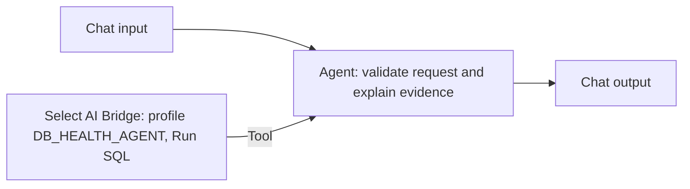

# ADB Health Monitoring Agent MVP

Created 24 September 2026 as a separate flow in Private Agent Factory. It was created as a draft; subsequent verification found it published, with the component settings unchanged. The creation/testing commands did not publish it, and the observed publication state was preserved.

- Flow name: **ADB Health Monitoring Agent MVP**
- Flow ID: `5C2A338670CA1162E0634815000AC353`
- Location: Workflows → ADB Health Monitoring Agent MVP → Edit / Playground
- Model: existing `llm_model_entry` (OCI), temperature 0.01
- Memory: disabled
- Database: ADB HEALTH MVP
- Select AI profile: DB_HEALTH_AGENT

Use the native **Tools → Select AI Bridge** component (`selectAIWorkflow`). The standalone Select AI component used in the old flow returns a message directly and is not the Agent tool connection used here.

The Bridge uses Profile mode, ADB HEALTH MVP, DB_HEALTH_AGENT, and Run SQL. Its Tool output connects to the Agent Tools input. Chat Input connects only to the Agent Prompt. The Agent Message output connects to Chat Output.

The complete custom instructions are in [monitoring-agent-instructions.txt](monitoring-agent-instructions.txt). They require clarification for nonsense, invalid parameters and ambiguous overnight windows; decline unrelated questions and unsupported historical performance comparisons; retain understandable typo handling; and explain empty results and source limitations. General slowness requests require both sessions and workload checks. Overall health uses a compact identity/session/storage/job summary and a second cumulative SQL check to reduce sequential tool calls.

This is an instruction-based MVP. Instructions do not provide a deterministic authorization boundary or guarantee SQL correctness. The existing database permissions and profile configuration remain unchanged; object-list enforcement is still disabled as previously requested. No new generic SQL tool, database grants, database objects or API key was added.

Open the flow in Playground to test it. The authenticated owner run endpoint is used by the test script. No integration key was created as part of this work.

Tests: `scripts/test_monitoring_agent.py --agent-id 5C2A338670CA1162E0634815000AC353`. This runs the existing 21 prompts plus three out-of-scope questions, using distinct rooms and saving responses under ignored `.local/paf-tests/` with restricted file permissions. It does not grade HTTP 200 as a behavioral pass. The original fixed-API tool-name expectations are not applicable to this Select AI Bridge flow.
